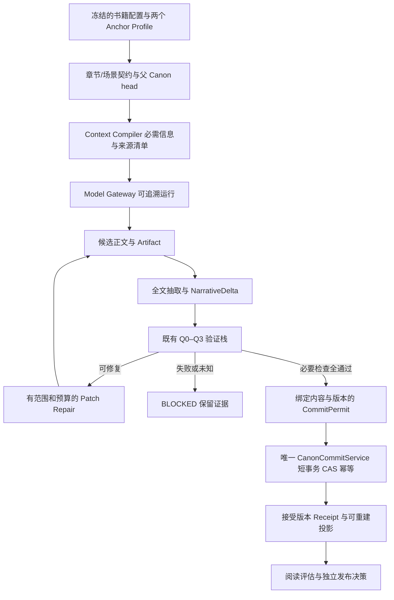

# ANovelOS：ccdoc 架构规划全面审核报告

**审核日期：2026-09-19｜对象：ccdoc 全部 25 份 Markdown｜目的：自动生产具备起点商业竞争力的中文长篇网文**

## 1. 审核结论与决策建议

**这份资料值得作为设计候选库保留，但不宜按“最终可执行版”整体进入开发。** 它提出了 Genre 领域化、事实有效期、模块化单体、质量检查和人工阅读等有价值的方向；然而最具体的模型、数据库、API 和工作流示例没有落实前文要求的 Canon 唯一提交边界，题材规则仍存在误报与漏报，作品质量和商业成效的验收也没有形成可信闭环。

当前能支持的目标是“搭建一个题材感知的小说生成原型”；尚不能据此承诺“稳定自动生产高质量长篇”，更不能把 30 章生成成功等同于“具有起点爆款生产能力”。缺口不仅是缺几个功能，而是**规范权威、叙事状态、受控提交、作品吸引力和效果证据之间的连接不完整**。

建议作出以下决定：

1. **继续使用用户已冻结的 P0—P14 路线。** ccdoc 的“战略重构 V1、先 Genre/Genesis、再补事务”等安排尚未获得替换这条路线的授权。
2. **允许开展 P0 规范收敛和仓库建设；不批准照抄 ccdoc 全套方案进入业务开发。** 本报告的阻断项应按对应阶段关闭，而非要求在 P0 实现全部业务能力。
3. **保留生产内核优先策略。** Narrative、Canon、Genre、Contract、Context、Gateway、单章流程、Q0—Q3、Patch Repair、双题材认证仍是主线。
4. **将“爆款”作为愿景，将可验收承诺拆开。** 分别证明生产可靠性、目标读者吸引力、真实曝光下的追读与付费表现；任何一条不能代替另外两条。
5. **不再补一份总体愿景架构。** 下一步是消解本报告中的冲突，修正既有规范，然后形成限定 V2-001—004 的 P0 执行文件。

审核形成 **24 项整改发现：8 项阻断、15 项高优先级、1 项一般问题**。这是对规划采用和阶段准入的分级，**不是已上线系统的漏洞等级**。详细机器台账见 [REMEDIATION_REGISTER.json](/Users/angyang/Documents/AI/ANovelOS/ccdoc-review-2026-09-19/REMEDIATION_REGISTER.json)。

## 2. 范围、证据与限制

### 2.1 审核覆盖

本次覆盖 ccdoc 的全部 **25 份文档、22,403 行、620,468 字节**，包括 00—11、12 的三部分、13—21 和 README。逐文件 SHA-256、行数和大小见 [audit-results.json](/Users/angyang/Documents/AI/ANovelOS/ccdoc-review-2026-09-19/audit-results.json)。所有结论针对该快照；若源文件修改，应重新定位与复核。

审核结合了用户明确给出的冻结路线、两个 Anchor Genre 和关键链，也参考了已有 [gptdoc 审核报告](/Users/angyang/Documents/AI/ANovelOS/architecture-review-2026-09-18/ARCHITECTURE_AUDIT_REPORT.md)。上一轮发现不会因为 ccdoc 写了“正确、保持”就自动关闭；同时不能把 gptdoc 的缺陷不加核查地算到 ccdoc。

本次没有修改 ccdoc，没有执行其中的 Git 推送、部署、删模块或发布命令，没有调用付费 Provider，也没有宣称完成 V2 集成测试、PostgreSQL 迁移认证或 CI 绿色。

### 2.2 证据分层

为避免与项目内部 E0—E4 等级混淆，本报告使用自己的审核标签：

| 标签 | 含义 | 能证明什么 |
|---|---|---|
| DOC | 原文可定位的定义、矛盾或遗漏 | 资料存在该表述/缺口 |
| PROBE | 原样提取的方法或等价最小机制的离线复现 | 该示例在给定输入下的行为 |
| INFER | 从领域需求与现有契约推出的设计风险 | 需要补充规范与验证，尚非线上故障 |
| SOURCE | 论文原站、项目官方仓库或官方文档核查 | 来源实际支持的有限主张 |

“文档没有说明如何做”与“实现一定做错”不同。本报告会明确区分。保留失败草稿本身不是错误；错误在于把失败候选当成功、缺少提交权限隔离，或无法证明 accepted 内容经过了必要检查。

### 2.3 已执行的验证

四份独立脚本均已成功运行，输出原始结果随报告交付：

| 范围 | 结果 | 解释边界 |
|---|---|---|
| Genre/模板：12 个探针 | 2 个正向控制成立；9 个设计期望不成立；1 个成长接口范围限制 | 第 9 个不是无条件缺陷：若仅用于“晋级”，拒绝倒退合理，但还需普通状态变化接口 |
| 核心模型/关系/DDL：9 项检查 | 序列化、区间、关系约束、映射与 SQL 静态依赖问题有证据 | 跨书关系使用 SQLite 复现同样的单列 FK 逻辑，未运行 PostgreSQL |
| 交付流程：12 项检查 | 验证失败继续保存、缺失指标默认通过、截断检查、缓存混淆、成本与备份问题等 | 使用局部内存替身；不代表整套 V2 已实现并出错 |
| 产品验证 | 单样本 A/B 晋级、三人比例、权重反例、成本/工期复算 | 统计例算不代表真实平台测量；与交付 A/B 探针有交叉，不能重复计为不同缺陷 |

## 3. 与最终目标是否对齐

### 3.1 “爆款”目标需要三条独立证据链

**生产可靠性**回答：能否按冻结设定连续写作；错误稿是否被拦住；重试、重启是否重复提交；人物、事实、读者已知信息是否正确延续。

**作品吸引力**回答：为何是这位主角、这个困境、这种选择；读者为何继续下一章；回报是否来自前文铺垫；情节和人物是否具有不可替代性。没有矛盾、禁词少、字数足，都无法单独回答这些问题。

**市场成效**回答：在什么题材、读者群、渠道、曝光、时间窗和成本下，获得怎样的实际续读及付费结果。“愿意追更”是问卷意向，模型打分是代理指标，真实付费是行为，三者不能互换。

因此，最终产品目标宜表达为：**提高原创中文连载作品在目标读者中的持续吸引力及商业成功概率，同时降低每个可接受章节的人工介入与总成本。** 不承诺每本都爆款，也不以这种不确定性为理由降低工程与作品标准。

### 3.2 当前规划的能力判断

| 能力 | 当前判断 | 对最终目标的影响 |
|---|---|---|
| 题材意识与专用提示词 | 有明确方向，语义隔离不足 | 能减少部分明显串题材，不能证明 Genre Architecture 成立 |
| Narrative/Canon | 原则较好，落地模型和入口未贯通 | 无法依靠现有 CRUD 自然获得长篇一致性 |
| 单章生成 | 流程轮廓清楚，失败/接受语义不足 | 可以做演示，不足以认证可靠生产 |
| 质量与修复 | 检测项丰富，权限和校准混乱 | 容易优化分数并反复改坏正文 |
| 人物与叙事吸引力 | 有动机、目标、爽点、钩子，缺少可追踪的因果与兑现 | 可能写成流畅但同质化的章节集合 |
| 自动化程度 | 有异步任务，没有完整人工投入账本和恢复协议 | 无法量化“自动”究竟依赖多少人工补救 |
| 真实读者验证 | 有三人试读，缺少独立对照与行为分母 | 可用于发现问题，不能作为商业结论 |
| 100—300+章能力 | 有远期目标，没有由当前结果推出的认证证据 | 30 章通过只能证明被测书和被测版本 |

### 3.3 应保留的内容

- **模块化单体**适合当前阶段。选择 PostgreSQL、明确模块职责、监控和备份方向合理；不必为了叙事图结构强制引入图数据库。
- **Genre 是一等领域概念**正确。不同题材的成长语义、世界规则和读者承诺确实需要分离。
- **State as Projection、Draft 非 Canon、唯一写入入口**是值得继承的原则，但须以实现和故障测试证明。
- **有效期与历史状态**比单个“当前属性”更接近连载叙事需求；还需补齐世界时间、呈现顺序和知情状态。
- **真人阅读全文、失败时暂停扩张、修订净收益验证**直接服务作品结果，应保留。
- **暂缓复杂混合题材、多 Agent、复杂图记忆和不必要基础设施**符合冻结范围。

## 4. 重点发现与整改要求

### CA-01｜阻断：权威规范、仓库策略和实施顺序没有收敛

**证据：DOC。** [README:12](/Users/angyang/Documents/AI/ANovelOS/ccdoc/README.md:12) 仍只索引 00—07；实际共有 25 份。更关键的是 [11:14](/Users/angyang/Documents/AI/ANovelOS/ccdoc/11_FINAL_EXECUTABLE_GUIDE.md:14) 的 Final 版本仍要求“不推倒重来”，[12 Part1:90](/Users/angyang/Documents/AI/ANovelOS/ccdoc/12_ARCHITECTURE_DECISION_RECORD_PART1.md:90) 继续先 Genre/Genesis，再实现 Canon 事务。它们没有通过明确 supersedes 关系替换旧稿，也没有与用户冻结的 P0—P14 对齐。

**影响：** 不同实施代理都可能“按文档执行”，结果却走不同仓库、不同边界和不同顺序。[03:25](/Users/angyang/Documents/AI/ANovelOS/ccdoc/03_KEEP_REFACTOR_DELETE_CHECKLIST.md:25) 的“Schema 不改”也不能覆盖后面 Fact 字段新增、Genre 扩展和旧契约缺陷。

**修正：** P0 建立规范索引、决策 ID、状态、适用版本和取代关系；ccdoc 逐项标为 ADOPT / ADAPT / DEFER / REJECT / HISTORICAL。复用对象应是通过回归验证的模块或概念，不能先规定保留 40%/重构 30%/删除 30%。

**关闭条件：** 所有首批任务只有一个现行阶段、一个规范来源链；旧部署/推送命令不会成为默认行动；V2-005 必须依赖 V2-001—004 的 P0 证据。

### CA-02｜阻断：Canon 唯一提交原则没有进入具体模型、仓储和 API

**证据：DOC、INFER。** [12 Part1:279](/Users/angyang/Documents/AI/ANovelOS/ccdoc/12_ARCHITECTURE_DECISION_RECORD_PART1.md:279) 宣称 Mint 原子写入；[15:539](/Users/angyang/Documents/AI/ANovelOS/ccdoc/15_SYSTEM_ARCHITECTURE_DESIGN.md:539) 的 CharacterRepository 却自行提交数据库事务。18 的持久化核心是 novels、characters、chapters 等业务表，未给出与 NarrativeDelta、Canon 提交记录、提交许可、投影版本的映射；[19:606](/Users/angyang/Documents/AI/ANovelOS/ccdoc/19_API_SPECIFICATION.md:606) 允许一次 PATCH 同时修改正文和 `status=published`。

并非必须使用某个类名或事件溯源技术；问题是替代设计没有说明这些语义由谁承担。单个仓储里调用 `commit()` 也可能属于一个受控服务，但当前契约没有限制它的调用边界。

**影响：** 人工改角色、生成章节、后台修订与发布接口可能成为互不一致的写入路径。历史投影无法仅凭“数据库里有最新角色”重建。

**修正：** 草稿可以写 Artifact/候选区；接受版本的正文、Delta、事实、receipt 与 head 必须通过同一个应用服务。CRUD 查询表可以作为投影；修改 Canon 的 API 必须提交有版本前提的变更命令。发布状态应引用已接受的内容哈希，不能同时暗改正文。

**关闭条件：** 对 CLI、API、任务、人工编辑和修复逐个验证：未经许可不能推进 Canon；改正文后旧许可失效；任何投影都能从权威记录重建。

### CA-03｜阻断：失败、未知、草稿保存、接受和发布未分离

**证据：PROBE、DOC。** [15:343](/Users/angyang/Documents/AI/ANovelOS/ccdoc/15_SYSTEM_ARCHITECTURE_DESIGN.md:343) 在 Genesis 验证失败后执行 `pass`，随后保存并返回普通结果；已用原样方法复现。Production 的质量分为 0 时仍进入保存路径，但**保存低分草稿本身可以合理**，缺陷是示例没有声明该结果仍处于候选状态，也未返回完整验收结果。[17:499](/Users/angyang/Documents/AI/ANovelOS/ccdoc/17_QUALITY_ASSURANCE_FRAMEWORK.md:499) 缺失质量指标时默认 100 分/无阻断，未被随机抽中就不要求人工审核。

**影响：** 检查器超时、没有运行、没有覆盖全文可能被当成“没有问题”。这与冻结的 Hard Gate 原则直接冲突。

**修正：** 每个必要检查必须返回 PASS / FAIL / UNKNOWN / NOT_RUN，并绑定被检查 artifact hash、范围和版本；后两种不能授权提交。候选保存、Canon 接受、内容发布使用独立状态和权限。CommitPermit 要绑定父版本、scope、正文、Delta、Contract、Genre、Context 与验证证据；字段可以通过引用闭包承载，不必重复塞入所有对象。

**关闭条件：** 缺少任何必需证据、空结果、失效证据、正文后半段未检查、检查后正文改变，均不能进入 accepted/published；失败产物仍可保留以便诊断。

### CA-04｜阻断：事务写法没有解决并发、重复投递和恢复

**证据：DOC、INFER。** [12 Part1:285](/Users/angyang/Documents/AI/ANovelOS/ccdoc/12_ARCHITECTURE_DECISION_RECORD_PART1.md:285) 先验证后开始事务，没有明确父 head 的事务内复查；快照在另一存储保存的提议与 PostgreSQL 事务边界未统一。[15:682](/Users/angyang/Documents/AI/ANovelOS/ccdoc/15_SYSTEM_ARCHITECTURE_DESIGN.md:682) 用任务 retry 重跑整个章节，没有定义逻辑 run、attempt、acceptance slot、冲突与未知完成结果。

**影响：** 两个 worker 可能基于同一旧状态生成并分别接受；提交成功但响应丢失后重试，可能再次生成/提交；只用 `(novel_id, chapter_number)` 唯一键阻止重复行，也不能解释重复调用应该返回哪份结果。

**修正：** P2 定义 CAS 和幂等语义：同 key 同输入返回同 receipt，同 key 不同输入明确冲突；过期 head 拒绝，不静默覆盖；一个章节接受槽只能有一个当前被接受版本。Provider 在数据库短事务之外调用；提交事务内验证 head、持久化 Delta/receipt/索引并推进版本。快照若为派生物，可提交后重建；若作为接受凭证则必须有完整持久化协议。

**关闭条件：** 并发提交、每个持久化边界 kill、提交后失联、重复投递、取消后迟到响应均有回归；Canon 至多接受一次。远端模型是否至多调用/计费一次取决于 Provider 能力，不能由本地缓存保证。Celery 的任务重投递需要应用幂等处理，参见[官方任务说明](https://docs.celeryq.dev/en/stable/userguide/tasks.html)。

### CA-05｜阻断：书籍与项目隔离没有贯穿数据库及上下文

**证据：PROBE、DOC。** [18:524](/Users/angyang/Documents/AI/ANovelOS/ccdoc/18_DATABASE_SCHEMA_DESIGN.md:524) 的 relationships 使用独立 `novel_id` 与两条只引用 character ID 的外键。等价 SQLite 约束验证表明：A 书关系可以连接 A 书人物和 B 书人物，所有单列外键仍合法。这是对约束机制的复现，非 PostgreSQL 漏洞实测。[15:547](/Users/angyang/Documents/AI/ANovelOS/ccdoc/15_SYSTEM_ARCHITECTURE_DESIGN.md:547) 查询只接受 character_id；上层如何保证 scope 未形成明确契约。

**修正：** 外部请求的鉴权、应用服务的 scope、仓储谓词、关系引用、Artifact、缓存、Context、验证结果都需携带或验证同一项目/书籍/分支边界。数据库可用 `(novel_id, id)` 唯一约束及组合外键实现同书引用；必要时再采用 RLS，不能将 RLS 当成自动替代应用授权。组合外键原理见[PostgreSQL 官方约束文档](https://www.postgresql.org/docs/current/ddl-constraints.html)。

**关闭条件：** 对每一类读写交换 novel/project/branch ID，均不得跨作用域读取正文、拼接关系、复用 Context 或接受 Delta；缓存命中仍执行授权。

### CA-06｜高：领域模型、JSONB、API 和序列化没有一致映射

**证据：PROBE、DOC。** 13 的 Character 使用 `character_id`，缺少所属书籍字段；[18:180](/Users/angyang/Documents/AI/ANovelOS/ccdoc/18_DATABASE_SCHEMA_DESIGN.md:180) 使用 `id`、必需 `novel_id`、`genre_attributes`；[15:541](/Users/angyang/Documents/AI/ANovelOS/ccdoc/15_SYSTEM_ARCHITECTURE_DESIGN.md:541) 直接 `CharacterModel(**character.to_dict())`，回读又访问表设计中没有的 `model.genre_id`。可以借助 ORM 属性和映射器解决，但文档未定义。

原样执行 [13:397](/Users/angyang/Documents/AI/ANovelOS/ccdoc/13_DATA_MODEL_COMPLETE_DEFINITION.md:397) 的序列化，确认 `cultivation_speed`、`comprehension` 丢失；UrbanWorldview 的 `social_circles` 也丢失。用序列化字典直接回构 dataclass 后再序列化，字符串枚举触发 `AttributeError`。

**修正：** 确立唯一 ID、scope、枚举、版本、序列化规范；Genre 专属数据由版本化扩展 Schema 验证，映射器显式还原类型。JSONB 灵活不等于无契约；不能靠字段名相似自动映射。

**关闭条件：** 每种非默认字段完成 domain→storage→domain 无损往返；未知枚举、错题材扩展、未支持 Schema 版本拒绝或走明确迁移；旧快照可按版本恢复。

### CA-07｜高：章节有效期尚不足以表达叙事事实、知识和变化

**证据：PROBE、INFER。** [12 Part1:168](/Users/angyang/Documents/AI/ANovelOS/ccdoc/12_ARCHITECTURE_DECISION_RECORD_PART1.md:168) 只有章节整数的开始/结束区间；[11:180](/Users/angyang/Documents/AI/ANovelOS/ccdoc/11_FINAL_EXECUTABLE_GUIDE.md:180) 据此判断矛盾。第 5 章前半学生、后半入职，两个事实在第 5 章都有效，无法区分场景前后。结束值为 0 时，示例把它当作无限期；若限定正章节，必须在输入层明确拒绝 0。

更重要的是：插叙发生的世界时间、正文叙述顺序、角色何时获知、作者何时确认，是不同维度。角色撒谎或误信不应直接污染作者真相；同一名字可以是别名或改名，不能把名称字符串永远不可变等同于稳定身份。[12 Part1:379](/Users/angyang/Documents/AI/ANovelOS/ccdoc/12_ARCHITECTURE_DECISION_RECORD_PART1.md:379) “冲突时高 confidence 优先”不能自动推翻已接受 Canon。

**修正：** P1/P2 定义事件顺序、故事内时间、叙述/披露位置与知识持有者；状态变化与事实纠错/retcon 分开。无需先做完整时态数据库，但数据模型必须能表达同章先后、前后版本及证据位置。成长模型允许失败、停滞、损失与恢复；晋级检查器可继续专门约束晋级。

**关闭条件：** 同章前后变化、插叙、未知未来、角色误信、别名改名、合法倒退和 retcon 各有反例；重新投影能得到对应时间与视角的状态。

### CA-08｜阻断：两个粗粒度 Genre 不能代表两个已冻结 Anchor

**证据：DOC、INFER。** [01:120](/Users/angyang/Documents/AI/ANovelOS/ccdoc/01_GENRE_SYSTEM_ARCHITECTURE_DESIGN.md:120) 的 urban 允许重生、系统和预知，又禁止超自然力量；[04:461](/Users/angyang/Documents/AI/ANovelOS/ccdoc/04_GENRE_SPECIFIC_PROMPT_TEMPLATES.md:461) 的玄幻禁止市场经济及商业竞争。这既没有定义重生是否是世界规则例外，也可能把玄幻商会交易误当类型污染。

**修正：** 保留 `urban.business.realistic` 与 `fantasy.eastern.progression` 两个 Anchor。分别冻结世界法则、时代科技、允许机制、冲突范围、成长维度、叙述风格与读者承诺。写实都市默认不注入重生/系统；如选择重生商战，应显式使用另一个受测 Profile 或明确的例外，不能悄悄改变 realistic 的含义。玄幻可有财富、组织、资源交易，不得无许可引入现代金融制度或技术。

**关闭条件：** 双包共享同一内核、不同扩展，Profile 版本与内容 hash 固定；书籍生产时不能由参考关键词重新决定 Genre。暂不扩展 30 个包，不妨碍基础模型正确分离这些维度。

### CA-09｜阻断：关键词检测不能作为题材事实的硬裁判

**证据：PROBE。** 原样提取 [01:702](/Users/angyang/Documents/AI/ANovelOS/ccdoc/01_GENRE_SYSTEM_ARCHITECTURE_DESIGN.md:702) 的 KeywordDetector 和 Registry，在都市/玄幻两个已给定检测器下执行自带七例测试：**6/7＝85.71%**，低于自设 90%；《一念永恒》测试文本得到双零分，按注册顺序误判都市。模糊样例无条件计正确，`min_confidence` 从未断言；归一化分数也没有概率校准。

其他反例：

| 输入 | 示例结果 | 问题 |
|---|---|---|
| “窗外下着雨，她等了一整夜。” | urban，所有分数 0 | 未知情况不弃权 |
| 关键词 CBD 与文本 CBD | 匹配分 0 | 只小写文本，没有统一关键词大小写 |
| “他把谈判当成一门修炼，努力突破销售瓶颈。” | 命中禁止元素 | 把现实修辞当世界规则违规 |
| “他摊开手掌，隔空让整栋大楼升上天空。” | 无违规 | 没有禁词也可能存在明确超自然因果 |
| “这个世界存在力量等级压制。” | 无违规 | 配置中的 forbidden_world_rules 没有被该检查器执行 |

**修正：** 分类只做建议，未知/冲突要返回弃权；生产约束由冻结 Profile 决定。词法用于便宜的候选定位，事实级判定需结合主体、行为、结果、语气、视角、引用/梦境和上下文；语义检查仍应返回证据与不确定性，不能伪装确定性真值。

**关闭条件：** 六类语义对照（实施法、谈论游戏、玄幻商会、现代券商混入、许可重生、未许可系统）全部覆盖；单独报告误报、漏报和未知率；10/30 章认证覆盖全文，不只测试类型识别。

### CA-10｜高：Temporal RAG 不能替代 Context Compiler

**证据：DOC、INFER。** [11:738](/Users/angyang/Documents/AI/ANovelOS/ccdoc/11_FINAL_EXECUTABLE_GUIDE.md:738) 的检索先按有效期过滤，再按语义与时间衰减取 top-k；这不足以保证主角身份、世界硬规则、未偿承诺与关键远期伏笔一定进入上下文。[16:587](/Users/angyang/Documents/AI/ANovelOS/ccdoc/16_LLM_INTEGRATION_STRATEGY.md:587) 超预算最终截断，也没有说明哪些约束绝不能被裁掉。

**影响：** 第一章种下的债务或致命秘密可能因为较旧、语义相似度低而消失；“角色不知道真相”也可能被作者全知检索污染。

**修正：** Context Compiler 应产出带来源和版本的 manifest：scope/head、Contract、硬 Genre 规则、必需实体、知识边界、活跃冲突与到期承诺是必需集合；语义检索只补充可选集合。缺少必需信息或必需集合超过预算，应明确失败或重规划。记录实际 tokenizer/估算误差，不把一种编码器的计数当所有 Provider 的精确计费。

**关闭条件：** 关键事实即使在第 1 章且与查询语义弱相关也不会丢；无权限/未来/错误视角信息不泄漏；模型切换及压缩后保留全部必要约束；Context 可以离线解释和重建。

### CA-11｜高：三稿制并未构成受控修复闭环

**证据：DOC、SOURCE。** [11:503](/Users/angyang/Documents/AI/ANovelOS/ccdoc/11_FINAL_EXECUTABLE_GUIDE.md:503) 的 A/B/C 最后直接返回 C，注释说“最佳版本”却没有候选比较或对 C 的完整重新检查。B/C 使用前稿和问题清单，不等于继承全部 Genre/Canon/Contract 约束。引用的 [HZ-KMNO 官方流程](https://github.com/HZ-KMNO/web-novel-writing-guidance-skill#-core-workflow) 包含 user feedback 和 user approval，不能直接证明去掉这些节点后全自动三稿仍有同样净收益。

**修正：** 按冻结 P7 先做 Patch Repair：明确问题、允许修改范围、原稿版本和影响分析；修补后对全文重新抽取与检查；原稿保留，修坏可回退，超过预算则 BLOCKED。整章重写和多稿策略作为对照实验，不默认每章三次调用。

**关闭条件：** 修复题材后新增事实错误、删掉兑现、改变人物动机或失去情节功能都能检出；只接受重新验证的候选；记录成对阅读偏好与缺陷增减，不能只看分数上涨。

### CA-12｜高：未校准分数重新获得发布和策略晋级权限

**证据：PROBE、DOC。** [05:253](/Users/angyang/Documents/AI/ANovelOS/ccdoc/05_V1_LESSONS_LEARNED.md:253) 规定未校准评价不能参与生产 Gate；[17:963](/Users/angyang/Documents/AI/ANovelOS/ccdoc/17_QUALITY_ASSURANCE_FRAMEWORK.md:963) 却按综合分直接发布。[17:823](/Users/angyang/Documents/AI/ANovelOS/ccdoc/17_QUALITY_ASSURANCE_FRAMEWORK.md:823) 的“显著性”实际只比较均值涨幅；原样运行对照/候选各 1 个评分、75 对 81，便返回 `deploy`。

此外，[17:31](/Users/angyang/Documents/AI/ANovelOS/ccdoc/17_QUALITY_ASSURANCE_FRAMEWORK.md:31) 的权重若按线性合成，其余全满而读者吸引力 0，仍为 90 分。这里只证明总分规范存在反例，不声称某个真实聚合器已部署。

**修正：** 正确性门禁、可读性诊断、读者偏好和商业结果分别表示，硬失败不能被均值抵消。P11 前评分用于排序和问题定位；即使 P11 后，也只有通过校准、在授权使用范围内的指标可以影响自动决策。策略晋级要求预先定义协议、独立留出数据、回归结果和不确定性。

**关闭条件：** 单样本、无对照、未校准、缺失数据和任一硬失败不能自动晋级；反馈数据中的正文指令不能覆盖 Judge 的系统规则；受测模型和评价器升级必须触发相应回归。

### CA-13｜高：试读意向、可读性与真实留存混用

**证据：DOC、算术复核。** [06:349](/Users/angyang/Documents/AI/ANovelOS/ccdoc/06_MILESTONE_DEFINITIONS.md:349) 采用三位读者，要求愿继续读 >60%、愿追更 >50%；两人同意即同时通过。即使假设独立随机样本，2/3 的 Wilson 95% 区间也约为 20.8%—93.9%；便利样本还有额外选择偏差，不能把该区间当实际起点读者的估计。

**修正：** 保留三人试读作为早期缺陷发现，把“前十章评分”准确命名为评分。正式作品试验应有目标题材读者、独立对照、盲法、实际读到的位置、弃读理由和作品级样本。P13 的曝光→开读→有效阅读→更新后续读→付费阅读使用各自分母，记录渠道和版本；不能把流量差异全部归因为文本改进。

**关闭条件：** P8/P9 可用小规模人工反馈，但不能宣称市场验证；商业晋级必须有单独协议。样本量依据基线、最小有意义差异和不确定性决定，不另编一个“万能人数”。

### CA-14｜高：类型模板把可选套路变成质量公理

**证据：DOC、INFER。** [04:154](/Users/angyang/Documents/AI/ANovelOS/ccdoc/04_GENRE_SPECIFIC_PROMPT_TEMPLATES.md:154) 等模板要求固定开局、每章小爽点、前 30 章若干重要女性角色；[04:549](/Users/angyang/Documents/AI/ANovelOS/ccdoc/04_GENRE_SPECIFIC_PROMPT_TEMPLATES.md:549) 要求玄幻每章战斗/机遇、每三章突破。它们可适合特定子类，但不应成为都市、东方玄幻或中文网文的普遍硬规则。

**影响：** 不同作品可能只换人名与背景，冲突、人物功能和回报完全同构。商业题材被压成财富升阶，玄幻被压成境界升阶；有阻力、有损失、有关系代价的叙事被当作“不进阶”。

**修正：** 将配方变成可选、版本化的创作策略。P4 的章节契约要能追踪“目标—阻力—选择—代价—结果—关系/认知变化—后续问题”，并关联承诺与兑现；不是要求每章齐填套路。都市区分个人资产、公司现金流、股权与估值；玄幻区分境界、能力条件、伤势、资源与信息优势，避免单一等级替代因果。

**关闭条件：** 同一 Genre 的不同 premise 在遮去名字后仍可被读者区分；关键情节能解释为什么发生、谁主动选择、付出什么；安静章节、失败章节与关系章节也可在满足其契约时通过。

### CA-15｜高：Model Gateway 尚未提供可追溯请求与安全重试语义

**证据：PROBE、DOC、INFER。** [16:562](/Users/angyang/Documents/AI/ANovelOS/ccdoc/16_LLM_INTEGRATION_STRATEGY.md:562) 以 `prompt + extra` 拼接缓存键，`('ab','c')` 和 `('a','bc')` 得到同一键；这是输入编码歧义，非 SHA-256 密码学碰撞。配置未要求 key 覆盖 provider/model、参数、模板/Schema/Genre/Canon 版本和 scope。[16:742](/Users/angyang/Documents/AI/ANovelOS/ccdoc/16_LLM_INTEGRATION_STRATEGY.md:742) 自由函数中调用 `self._add_feedback_to_prompt`，重试路径实测触发 NameError。

**修正：** 使用有类型、有边界的规范序列化请求描述；区分逻辑请求、网络重试、主动重采样、修复版本。ModelRun 记录请求哈希、Provider 版本、响应/部分响应、解析状态、usage、费用及未知结果；断流、超时、拒绝、截断、限流和能力不支持分别处理。Fallback 需要能力匹配和显式追踪，不能只换模型名。

**关闭条件：** 不同 scope 或模型参数不会错误复用；重启后恢复的是同一 run；未知计费可对账；成功 JSON 必须通过约定 Schema，模型调用成功不等于叙事任务成功。

### CA-16｜高：成本表存在量级错误，且没有接受章节的全成本口径

**证据：算术复核。** 按 [16:32](/Users/angyang/Documents/AI/ANovelOS/ccdoc/16_LLM_INTEGRATION_STRATEGY.md:32) 自己列出的单价计算：

| 调用 | 文档估价 | 按文档单价重算 |
|---|---:|---:|
| Opus：8K 输入＋8K 输出 | $1.20 | $0.72 |
| Sonnet：4K＋2K | $0.18 | $0.042 |
| Sonnet：8K＋4K | $0.84 | $0.084 |
| Sonnet：6K＋2K | $0.48 | $0.048 |
| Haiku：2K＋0.5K | $0.01 | $0.001125 |

沿用其 1 次大纲、6 次角色/世界观、1000 次正文、200 次修订、2000 次验证的例算，总计为 **$96.822**，不是 $958.28。**这只是文档内部算术核查，不是当前可用模型的报价或真实生产预算。** [11:685](/Users/angyang/Documents/AI/ANovelOS/ccdoc/11_FINAL_EXECUTABLE_GUIDE.md:685) 又把 $0.020 说成低于 $0.01；同一文档对 30 章同时出现 $0.30 与 $0.75 门槛。

**修正：** P5 起建立调用账本，按接受章节/每千中文字计入规划、抽取、所有 Judge、重试、废稿、修订、检索、基础设施与人工时间。缓存节省必须按实际可缓存请求的成本加权，不能拿 30% 命中率直接扣全部成本。

**关闭条件：** run 汇总与调用 ledger 一致；失败与未知费用可见；预算、P50/P95 及人工介入可查；任何成本优化都不得省略强制门禁。

### CA-17｜阻断：CI 示例未实现被冻结的 P0 治理门禁

**证据：DOC、SOURCE。** [20:494](/Users/angyang/Documents/AI/ANovelOS/ccdoc/20_DEPLOYMENT_OPERATIONS_GUIDE.md:494) 主要是 pytest→构建→部署；[21:963](/Users/angyang/Documents/AI/ANovelOS/ccdoc/21_TESTING_STRATEGY.md:963) 增加 Unit/Integration 和覆盖率，但没有形成 Schema、Architecture Fitness、Secret Scan、依赖安全、CAS/幂等的不可跳过链。测试 workflow 的 PostgreSQL/Redis 服务没有端口映射，任务在 runner 主机执行却访问 localhost；也未在片段中建立所需 test 数据库。[GitHub 官方说明](https://docs.github.com/en/actions/tutorials/use-containerized-services/use-docker-service-containers) 明确这种主机访问方式需要映射服务端口。

**修正：** 按用户已冻结的 Static→Unit→Contract/Schema→Architecture Fitness→Security→PostgreSQL→Deterministic E2E→Genre Smoke→Controlled Live 分层建立 job。不要机械要求 GitHub Actions 写 `allow_failure:false`：这是 GitLab 语法；选定 CI 后使用其等价阻断设置和 required checks。原项目 GitLab 链接与文档 GitHub 流程也需明确采用哪一套。

P0 的业务功能尚未存在，不应伪造 Canon/30章绿灯。此时要证明适配的基础设施与负向夹具确实能让门禁失败；后续阶段再激活对应业务认证。

**关闭条件：** 干净环境建库/迁移/测试通过；注入违规依赖、假密钥和违反架构边界的夹具能让流水线变红；不能通过删测试、全 skip、永远 Mock 或手工标记 CLOSED 绕过。Live Provider 可 scheduled/protected manual/release gate，不必每个 commit 运行。

### CA-18｜高：DDL 存在可定位的落地错误与依赖缺口

**证据：静态核查，未运行 PostgreSQL。** [18:720](/Users/angyang/Documents/AI/ANovelOS/ccdoc/18_DATABASE_SCHEMA_DESIGN.md:720) 的 `chapter_with_context` 选取 `c.*`，又无别名选取 `n.genre_id`，而 chapters 本身已有 genre_id，造成视图输出列名重复。[18:508](/Users/angyang/Documents/AI/ANovelOS/ccdoc/18_DATABASE_SCHEMA_DESIGN.md:508) 使用 `to_tsvector('chinese', …)`，初始化只声明 uuid-ossp/pg_trgm，未定义对应文本搜索配置或分词扩展。

**修正：** 显式列名与别名；在目标 PostgreSQL 版本中选择并锁定中文检索方案，或先不用该全文索引。对所有枚举、JSON 扩展、版本字段、关联 scope 和迁移回滚逐项建立契约；不把表存在等同于域不变量成立。

**关闭条件：** 从空库执行完整迁移、装载双 Anchor 夹具、升级旧快照和导出恢复都通过；中文检索有真实文本例子；不得将 SQLite 的通过结果替代 PostgreSQL 的 JSONB、锁和事务测试。

### CA-19｜高：部署、健康检查和备份可能给出错误成功信号

**证据：DOC、PROBE。** [20:364](/Users/angyang/Documents/AI/ANovelOS/ccdoc/20_DEPLOYMENT_OPERATIONS_GUIDE.md:364) 给 Redis 设置密码，而 API/worker 的 REDIS_URL 未带认证。健康端点在依赖失败时仅返回 JSON `unhealthy`，没有相应失败 HTTP 状态，[20:905](/Users/angyang/Documents/AI/ANovelOS/ccdoc/20_DEPLOYMENT_OPERATIONS_GUIDE.md:905) readiness 永远 True；上层 `curl -f` 无法据此正确阻断。Dockerfile 使用 curl 健康检查却未显式安装，部署镜像名与 CI 推送的 ghcr 路径也未一致绑定。

[20:931](/Users/angyang/Documents/AI/ANovelOS/ccdoc/20_DEPLOYMENT_OPERATIONS_GUIDE.md:931) 备份脚本只有 `set -e`，用 `pg_dump | gzip` 并以文件存在判成功。等价最小 shell 复现：生产者退出 2、gzip 产出有效空压缩文件，脚本退出 0 并报成功。没有接触真实数据库或备份。

**修正：** 统一配置、认证和镜像 digest；健康状态的 HTTP 返回值与依赖状态一致；部署按已验证的兼容迁移协议切换版本，避免先启动新服务再补必需 schema。备份使用失败传播、校验、隔离恢复与恢复目标验证。日志中不能直接暴露 Provider 密钥、原始私有材料及无脱敏连接串；这项是设计要求，不是本次发现了活密钥泄漏。

**关闭条件：** Redis/数据库失联、镜像不匹配、迁移失败、dump 失败、备份截断均能使操作明确失败；恢复后的 Canon、Artifact 哈希与 head 可对账。真实恢复演练在早期保留最小闭环，不需提前建设大型运维平台。

### CA-20｜高：研究证据被外推为项目收益与必要范围

**证据：DOC、SOURCE。** [11:1213](/Users/angyang/Documents/AI/ANovelOS/ccdoc/11_FINAL_EXECUTABLE_GUIDE.md:1213) 将不同研究指标合成为本项目质量提升 25—35%，12 又改为 30—40%。SCORE v1 摘要确有被引的 23.6%、41.8%、89.7%，**不能说该组数字是凭空编造**；但[其 v1](https://arxiv.org/html/2503.23512v1) 与[当前 v6](https://arxiv.org/html/2503.23512v6) 的叙述、任务和表格必须分开，不能直接迁移为中文双题材 30 章生成或付费增益。

[09:498](/Users/angyang/Documents/AI/ANovelOS/ccdoc/09_PREARCHITECTURE_VS_INDUSTRY_DEEP_DIVE.md:498) 用英语 GPT-2 的固定 PPL 区间判“AI 味”且指定置信度，也没有中文题材校准。其[官方模型卡](https://huggingface.co/openai-community/gpt2) 不能支持这套中文阈值。情感状态机、词汇熵同样可以是诊断候选，不自动成为文学质量真值。

**修正：** 来源台账记录版本、任务、语言、样本、基线、评价方法与适用范围。将“论文证明本项目必增益”改为可证伪实验假设。竞品未观察到的能力不得写成“所有项目都没有/独创”；行业采用比例须给分母、判定标准和快照。

**关闭条件：** 本项目收益声明必须能定位到本项目实验；不再把多个不可比百分比相加或用于 ROI 承诺。详细来源边界见 [产品专项报告](/Users/angyang/Documents/AI/ANovelOS/ccdoc-review-2026-09-19/product-review.md)。

### CA-21｜高：排期和范围扩张缺少关键链约束

**证据：DOC、算术复核。** [11:1093](/Users/angyang/Documents/AI/ANovelOS/ccdoc/11_FINAL_EXECUTABLE_GUIDE.md:1093) 同期加入 19 Checker、三稿制、Temporal RAG、情感检查、Token 熵/PPL。[12 Part3:515](/Users/angyang/Documents/AI/ANovelOS/ccdoc/12_ARCHITECTURE_DECISION_RECORD_PART3.md:515) M1 列项约 9 人周排 6 周，M2 约 12 人周排 8 周；并行资源或任务重叠可能解释，但没有写明，对照单人开发估算不足以执行。

**修正：** 重新按 V2 任务依赖和验收排程，先让一章端到端可靠。必要的时间语义属于 Narrative/Canon，不应延期；复杂检索优化和文学诊断不应仅因“研究推荐”成为早期必需。Redis/Celery 可作为实现选择，不是用了就过度设计；必须说明其解决的真实调度需求和新增恢复责任。

**关闭条件：** 每项早期新增工作映射回关键链问题、产物和测试；超范围功能明确 DEFER；工期标明人员、依赖、未知项及证据，不能以降低质量门槛补偿超期。

### CA-22｜一般：示例尚不能承担“可直接执行”的身份

**证据：PROBE、DOC。** [04:705](/Users/angyang/Documents/AI/ANovelOS/ccdoc/04_GENRE_SPECIFIC_PROMPT_TEMPLATES.md:705) 的 format 注入缺少 `forbidden_world_rules` 和 `reference_analysis`，模板 JSON 大括号也会被误作替换字段，已复现 KeyError。16 的 f-string 混入 Jinja 控制语法；17 的 TextQualityChecker 片段语法解析失败；[21:377](/Users/angyang/Documents/AI/ANovelOS/ccdoc/21_TESTING_STRATEGY.md:377) 所谓合格文本夹具实际 800 字，却断言不少于 1800 字。

**修正：** 示例分为可执行规范样例、伪代码和历史说明；真正的规范样例移至仓库并由文档引用，模板使用严格变量检查和专用渲染器。不要统计所有包含省略号的代码块为“代码错误”，本报告仅针对明确列出的样例。

**关闭条件：** 可执行示例编译与对应负向测试通过；所有变量、字段和状态一致；后稿不再引用已停用示例作为实施入口。

### CA-23｜高：Reference 原创边界与学习/评测隔离未成为验收协议

**证据：DOC、INFER。** [05:414](/Users/angyang/Documents/AI/ANovelOS/ccdoc/05_V1_LESSONS_LEARNED.md:414) 已提出 EvidencePack 和 Writer 不读原文；这是优点。但 04 把具体名作桥段与人物功能写成配方。后期 ADR 暂缓 Few-shot，应承认该范围控制，不能说现行方案必然要求复制参考全文。

**修正：** 当前只保留 provenance、输入隔离与接口，不抢做 Reference 产品。P10 记录来源、允许用途、抽象过程及新作品在核心因果、人物关系、选择与兑现上的差异。P11 以作品/来源划分学习、开发、校准和测试集，防止一边根据测试书改 prompt、一边称独立提升。

**关闭条件：** 换名复写不能仅凭“没有原文输入”自动通过；相似度低也不能自动视为原创证明；外部材料中的指令不得越过资料边界。本报告不对版权或起点当前准入规则作法律结论。

### CA-24｜高：长期自动写作的成功口径缺少人工贡献与叙事债务

**证据：DOC、INFER。** 当前里程碑主要聚焦类型、字数、评分和 30 章缺陷。[13:754](/Users/angyang/Documents/AI/ANovelOS/ccdoc/13_DATA_MODEL_COMPLETE_DEFINITION.md:754) 虽有 Outline/Arc/ChapterOutline，仍未与可恢复生产契约一起形成承诺到期、兑现证据、人物选择后果、章节版本影响范围及人工投入的完整认证口径。

**修正：** 不提前实现 P12/P14，但现在记录接受章的人工介入分钟、重写比例、失败尝试、重复情节机制、活跃承诺、逾期兑现和未解决冲突。长篇演化应允许经验证的计划更新，禁止为迎合后来提纲静默改写旧 Canon。

**关闭条件：** 10/30/100/300+ 章按实际长度分别认证；每个阶段报告是否因人工重写才成功、是否牺牲前文承诺；30 章不外推全部题材或百万字。自动化衡量的是必要人工投入持续下降且质量不退化，而非点击按钮后出现一堆文件。

## 5. 最小修正后的生产闭环

以下是对冻结架构的落地约束，不是新增第 16 份总体架构研究，也不要求采用所有示意类名。

该闭环还必须满足五项细节：

1. **Bootstrap 可以小，不可以没有。** P2/P6 所需人物、世界观、最初冲突可使用手工审核的最小书籍配置和固定测试书，不必等待 P10 自动 Genesis；其导入同样经过唯一 Canon 路径。
2. **场景内有临时状态，章节有明确接受单位。** 前一场景产生的临时事实可供后一场景使用，但在整章通过前不能污染权威 Canon；失败整章可以完整丢弃候选状态。
3. **抽取不是事实真相的完美感知器。** 每一项变化有正文证据位置；没有抽取出变化不等于正文没有违规。对全文覆盖、未知实体、未解析片段和遗漏事实单独记录。
4. **被接受正文与事实同步。** 如果事实不再能被接受的正文支持，或正文更改后事实未重抽，必须失效原许可并重新验证；不能只修一边。
5. **发布与 Canon 接受分离。** 技术通过不等于商业值得发布；后续自动发布需要明确产品授权、当时的平台规则和额外发布条件，本次审核不执行发布。

## 6. 中文网文专项验收建议

### 6.1 两个 Anchor 的对照设计

| 维度 | urban.business.realistic | fantasy.eastern.progression |
|---|---|---|
| 权威世界规则 | 现实因果，超自然机制默认禁止 | 明确冻结的超自然法则及能力边界 |
| 成长 | 技能、组织、关系、信誉、财富的有因果变化 | 境界、技能、资源、地位、认知的有代价变化 |
| 基本一致性 | 个人与公司资产分开；时间、合同和信息来源一致 | 能力条件、伤势、资源消耗、承诺代价一致 |
| 合理但不应误杀 | “修炼谈判技巧”、游戏讨论、影视引用 | 商会、拍卖、资源交换、政治关系 |
| 应阻断 | 无许可隔空移物、未来记忆直接成为事实 | 无许可现代券商、互联网或科技规则侵入 |
| 文学成功条件 | 决策有压力，交易/竞争改变人物命运 | 获胜有铺垫和代价，能力增长改变选择空间 |

这两组规则只定义本次认证 Profile，不声称囊括所有都市/玄幻。题材规则、商业事实核查和真实世界咨询也应分离；小说中的金融情节检查不是向读者提供投资建议。

### 6.2 可读性不能压成“爽点数量”

每章人工抽查/整书阅读至少记录：本章哪件事真正改变了；读者在意谁和什么；主角做了什么选择；对抗者是否有合理目标；回报是否得到前文支持；结尾的问题是否与人物命运有关；是否存在靠隐瞒本应知道的信息制造假悬念。

长线还要看：目标是否变形、配角是否仅为夸主角、相同打脸是否重复、升级是否通货膨胀、旧承诺是否被新机遇遮盖、关系变化是否留下后果。这些可先通过轻量结构化批注获得，不要求现在建设 Corpus Learning 或 Reader Agent。

### 6.3 认证必须同时测试“自然产出”和“故意注入错误”

自然产出评估错误发生率与实际作品质量；注入错误评估门禁能否抓住已知问题。两者分母不同，不应合成一个“通过率”。至少包括：

- 文本末段才出现违规；否定、引用、比喻、梦境与真实事实的对照。
- 都市经营损失、玄幻受伤/境界变化、同章知识更新和人物欺骗。
- 已通过检查后换正文、换 Delta、换 GenrePack、换父 head。
- 生成中断、重复执行、提交后失联、乱序章节和失败后恢复。
- 两本书 ID 互换、缓存相同文本不同 scope、未授权引用。
- 修复消除一个错误却引入另一个；原稿优于修订稿。

每份认证固定代码 commit、Schema/Genre/Prompt/模型配置、输入书配置、run/attempt、全文/证据 hash、失败与人工操作记录。Live 结果有随机性，应保存实际产物；重放产物用于流程重现，重新调用 Provider 用于稳定性评估，两者分别报告。

## 7. 对已冻结 P0—P14 的准入补充

| 阶段 | 本轮应增加或落实的证据 | 对应发现 |
|---|---|---|
| P0 Repository & Governance | 权威索引、唯一任务状态、锁定依赖、负向架构/安全夹具、真实 PostgreSQL 测试环境 | CA-01、17、21、22 |
| P1 Narrative Kernel | 稳定身份、实体/关系/知识/事件/承诺、明确时间与因果语义 | CA-06、07、14、24 |
| P2 Canon Kernel | Bootstrap、唯一写入、scope、CAS/幂等、快照恢复、版本回放 | CA-02—05、18 |
| P3 Genre Kernel | 两个精确 Anchor、版本化扩展、语义正反例与 UNKNOWN | CA-08、09 |
| P4 Planning & Contracts | 章节与场景目标、必需变化/禁止变化、信息与兑现要求、受控计划更新 | CA-10、14、24 |
| P5 Context & Model Gateway | 必需上下文清单、调用身份、失败语义、请求隔离、真实费用账本 | CA-10、15、16 |
| P6 Single-Chapter Production | 候选/accepted 分离、可恢复端到端流程、完整追踪 | CA-02—05、15 |
| P7 Quality & Repair | 按既有 Q0—Q3 职责实现，缺失证据不能通过，修复后全文重验 | CA-03、09、11、12 |
| P8 Dual-Genre 10-Chapter | 共享同一内核，全文语义隔离、正文阅读、自然错误与注入错误分开 | CA-08、09、13、24 |
| P9 30-Chapter | 因果与承诺兑现、全篇阅读、故障恢复、完整成本及人工贡献 | CA-11、13、14、16、24 |
| P10 Genesis & Reference | 多源证据、原创差异、用途和版本追踪 | CA-23 |
| P11 Calibration / Learning | 作品级独立留出、校准、修订净收益、策略晋级协议 | CA-12、13、20、23 |
| P12 100-Chapter | 长线伏笔/人物弧、规模和人工介入趋势、持续恢复可靠性 | CA-07、19、24 |
| P13 Reader / Market | 真实行为与付费的分母、渠道、队列、版本及统计不确定性 | CA-13、16、20 |
| P14 300+ / Million-word | 世界扩张、重复机制、长期债务、主线闭合及持续阅读表现 | CA-14、24 |

P6/P7 的阶段边界须由机器依赖说明：开发工作流骨架时可以只跑适配的测试；“可靠单章生产已认证”必须等待必要 Q0—Q3 与修复门禁就绪。不能用“后面才做质量”让不受控正文先成为 Canon。

用户原定 Critical Path 应继续保持。早期任何新技术先回答：它修复哪一项必须的不变量、让哪个失败反例通过，或为哪项冻结验收提供证据。回答不清楚的先不进入关键链。

## 8. P0 下一步应交付什么

建议下一份执行文件仍为 **`PHASE_0_REPOSITORY_BOOTSTRAP_EXECUTION.md`**，只负责 V2-001—004，内容是具体执行与验收，不重新研究全架构。本轮没有代替用户执行仓库重建。

最小交付要求：

1. 新仓库布局和模块依赖图；业务占位不冒充业务实现；旧 V1 可复用件有来源与回归证据。
2. Normative Index：冻结路线、gptdoc 规范、ccdoc 候选、历史稿的权威顺序和取代关系；首批任务逐项绑定规范、测试、产物。
3. 锁文件、最小 PostgreSQL 环境、迁移入口、可复现开发命令；生成物/环境变量模板不包含真实 secret。
4. Architecture Fitness 有正反夹具：禁止第二条 Canon 写入依赖、领域核依赖 Provider/UI、跨 Genre 专属 Schema 反向侵入核心等规则按阶段生效。
5. Secret/dependency/Schema/Unit/Contract 等门禁在选定 CI 平台上真正阻断；“没有扫描到任何文件”的成功不能算门禁已成立。
6. `OPEN→IN_PROGRESS→IMPLEMENTED→VERIFIED→CLOSED` 由代码、测试、CI 与验收证据共同约束；文档写完只能关闭文档任务，不能关闭对应运行能力。

**P0 绿色之后再进入 V2-005。** 若后续出现 Canon corruption、secret leak、duplicate commit、cross-project leak、hard gate bypass 或第二 Canon path，按用户冻结原则停止功能扩张，完成根因、修复、回归与验证后再恢复。

## 9. 资料处理建议

| 资料 | 建议身份 | 处理 |
|---|---|---|
| 00/02/03/06/07/README | 历史策略与候选执行资料 | 保留经验；旧复用比例、路线和命令不直接执行 |
| 01/04 | Genre 设计候选与示例策略 | 保留领域化方向；重做 Profile 语义、验证器与模板契约 |
| 05 | 原则性经验来源 | 将硬门禁、Draft/Canon、Evidence 边界落实为规范与测试 |
| 08/09/10 | 外部研究资料 | 引用补版本和边界；移除无法复核的普遍性/收益承诺 |
| 11/12 | 尚未收敛的实施建议/ADR 集 | 逐决策映射冻结路线；不得整体宣告 Final 可执行 |
| 13/18/19 | 数据与 API 草案 | 先补 Canon、scope、版本与映射，再生成机器契约 |
| 14/15/16 | 技术选型与应用骨架候选 | 模块化单体可保留；工作流与 Gateway 围绕事务/恢复重写 |
| 17/21 | QA 与测试候选 | 保留分类和人工反馈；拆分硬门禁、诊断和商业验证 |
| 20 | 部署运维草案 | 最小配置先真实验证；修复认证、健康、备份与发布链 |

gptdoc 在规范分层、机器任务、Canon/许可及认证分阶段方面更接近冻结方向，但上一轮已经证实它同样存在契约和依赖缺陷，不能未经整改直接照搬。合理整合方式是**一条冻结路线、一套修正后规范、多份可追溯候选资料**，而非 GPT 文档与 Claude 文档各自成为一个平行架构。

## 10. 审核后的最终判断

**方向可以继续，整包直接实施不通过。** 当前最危险的不是功能不够，而是“理念上唯一 Canon、实现上多入口”“目标上爆款、验收上分数”“要求上自动、实际贡献中人工未计量”的错位。

修正这些错位不需要提前建设庞大的市场智能系统。最有价值的下一个里程碑是：同一内核在两个冻结 Genre 下，生产一章有明确叙事价值、全文经过验证、可恢复且只提交一次的正文；随后用 10 章、30 章的真实产物和阅读证据逐步提高可信度。高级智能应在这个基础上证明增量收益。

---

### 附：交付文件与复现说明

- 主报告：本文件。
- 产品/外部研究专项：[product-review.md](/Users/angyang/Documents/AI/ANovelOS/ccdoc-review-2026-09-19/product-review.md)，含 12 项展开论证和有限来源核查。
- 24 项机器整改台账：[REMEDIATION_REGISTER.json](/Users/angyang/Documents/AI/ANovelOS/ccdoc-review-2026-09-19/REMEDIATION_REGISTER.json)。
- 文档清单、哈希和 Genre/模板探针：[audit-results.json](/Users/angyang/Documents/AI/ANovelOS/ccdoc-review-2026-09-19/audit-results.json)、[audit_ccdoc.py](/Users/angyang/Documents/AI/ANovelOS/ccdoc-review-2026-09-19/audit_ccdoc.py)。
- 核心模型探针：[core-probes.py](/Users/angyang/Documents/AI/ANovelOS/ccdoc-review-2026-09-19/core-probes.py)、[core-probe-results.json](/Users/angyang/Documents/AI/ANovelOS/ccdoc-review-2026-09-19/core-probe-results.json)。
- 工作流/交付探针：[delivery-probes.py](/Users/angyang/Documents/AI/ANovelOS/ccdoc-review-2026-09-19/delivery-probes.py)、[delivery-probe-results.json](/Users/angyang/Documents/AI/ANovelOS/ccdoc-review-2026-09-19/delivery-probe-results.json)。
- 产品验证探针：[product-probes.py](/Users/angyang/Documents/AI/ANovelOS/ccdoc-review-2026-09-19/product-probes.py)、[product-probe-results.json](/Users/angyang/Documents/AI/ANovelOS/ccdoc-review-2026-09-19/product-probe-results.json)。

全部脚本是文档级离线验证，不修改原始资料。运行方法及来源路径说明见 [README.md](/Users/angyang/Documents/AI/ANovelOS/ccdoc-review-2026-09-19/README.md)。压缩包只包含审核产物，不包含原始项目、密钥、运行数据库或付费模型结果。
