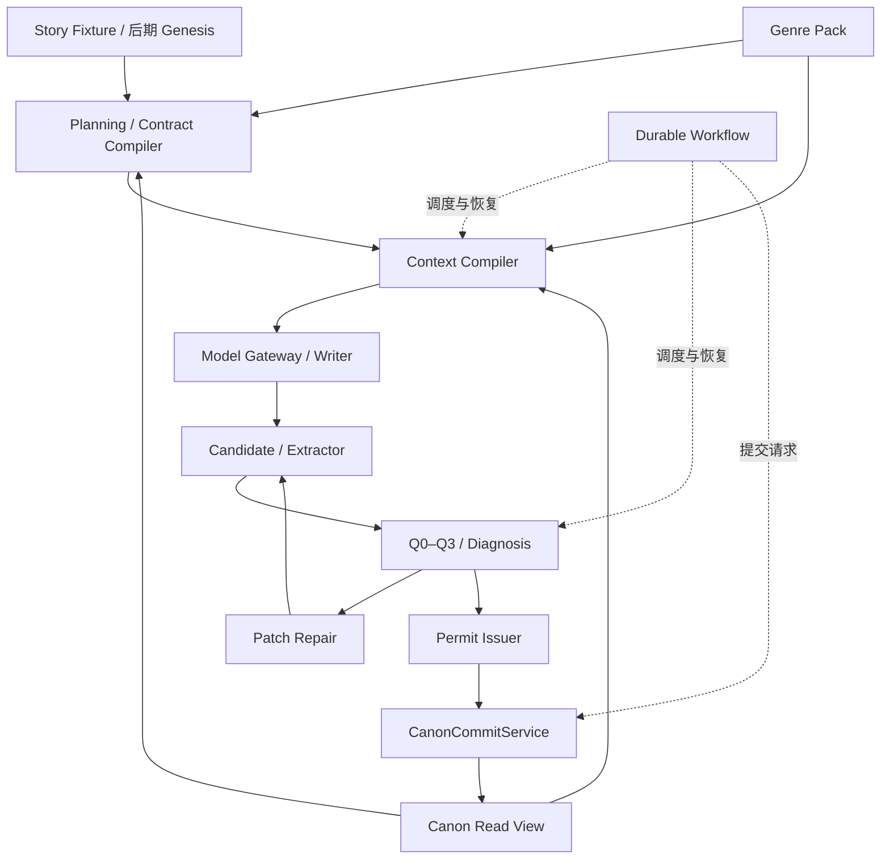

# 架构与依赖基线

## 1. 结构

采用模块化单体。模块化边界先由公开接口、依赖检查和数据库写权限建立，不依靠部署成多个服务建立边界。



## 2. 模块职责与禁止依赖

| 模块 | 对外职责 | 禁止事项 |
|---|---|---|
| domain | 实体、知识、时间、类型化变化、端口定义 | Provider SDK、数据库实现、题材专属字段 |
| canon | 读取、提交、分支、事件与投影 | Writer 直接仓储写入、第二真相库 |
| genre | Pack 注册、扩展与世界规则 | 静默 fallback、把市场趋势当硬世界规律 |
| planning/contracts | 意图、承诺、滚动计划、编译合约 | 绕过 Canon 改历史、项目数据硬编码 |
| context | 角色输入、必需项、预算与血缘 | 跨项目检索、静默丢弃必需约束 |
| gateway | Provider 适配、请求身份、费用与未知状态 | 向领域层泄漏厂商协议 |
| workflow | 阶段调度、检查点、恢复、生产状态 | 将“调用成功”视为“章节接受” |
| quality/repair | 检查、诊断、补丁、重验 | AI 自行签发 Permit、评分抵消硬失败 |
| intelligence/learning | P10/P11 后的参考和学习 | 原始参考直达 Writer、直接写 Canon |
| platform | 连接、授权、配置、追踪、存储适配 | 以万能 platform 模块绕过领域边界 |

进程内权限用依赖/能力注入与运行检查控制；数据库角色和写入口是第二层防线。DB 权限不能单独证明同一进程中的任意模块不会误用连接。

## 3. 目标目录

```text
plan/                 当前规范与机器实施资料
src/anovel/           domain canon genre planning contracts context gateway workflow quality repair platform
specs/                已修正、当前启用的 schemas / genres / policies / fixtures
tests/                unit contract architecture integration regression certification live_provider
migrations/           经版本管理的数据库迁移
scripts/              开发和 CI 命令入口
pyproject.toml        构建与工具配置
uv.lock               唯一依赖锁
.python-version       实际选择的精确 Python 版本
compose.yaml          PostgreSQL 测试环境
.gitlab-ci.yml        本项目实际 CI
```

当前只是目标目录，不在本次资料整理中创建空业务模块冒充实现。P10/P11 模块无需在 P0 装入依赖或服务。

## 4. 技术选择

采用已有设计方向：Python 3.12 系列、领域值对象/类型化接口、Pydantic v2 边界验证、PostgreSQL、SQLAlchemy 2.x、Alembic、pytest、JSON Schema Draft 2020-12。统一采用 uv 维护锁文件，避免多个依赖真相源。

精确 Python 补丁、PostgreSQL 主版本与镜像摘要、工具和依赖版本由 V2-001 在真实环境验证后锁定；本资料不编造安装结果或当前最新版本。Pydantic 与手工 JSON Schema 之间必须选定生成/对账策略，不能让两套类型各自演进。

首次模型集成采用可替换 Provider Adapter。模型具体名称、费用和支持能力在 P5 真实检查后配置并记录，不硬编码到领域内核。

## 5. 实施接缝

P2 可以通过隔离的测试 issuer 验证提交协议，生产模式不得接受测试 Permit。P6 可以用明确的 fixture 驱动流程，完整生产放行必须等待 P7 的 Q0–Q3 和 Permit 集成。P10 的 Genesis 使用同一 Canon 写路径，不新建初始化旁路。

## 6. 统一执行服务与可检查产物

CLI、任务接口及未来 UI 只做输入/展示适配，调用同一 Workflow 应用服务；不得各自实现生成、重试或接受章节逻辑。外部 Agent 只能提出有类型的操作请求，真实完成状态来自持久化产物与收据，不能解析模型一句“已完成”就推进状态。

对已冻结的输入，Contract/Context 编译提供无需调用生成模型的本地检查入口，输出完整版本绑定与选取清单；需要生成计划的动作单独标明。P5/P6 先具备机器产物，P8 inspector 再提供 CLI/报告展示，不把复杂作者工作台提前设为依赖。
