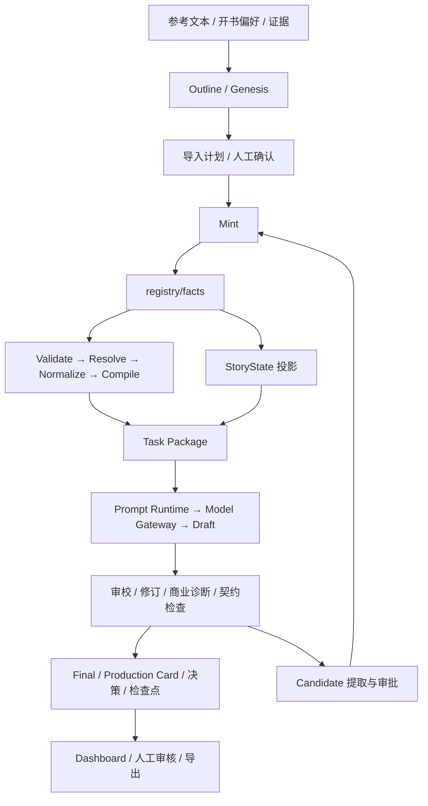

# AINovel 项目深度分析

分析日期：2026-09-18。仓库：https://gitlab.com/ayitnovel/ainovel.git。

分析基线：`main`，提交 `334518d96e8f19daee27bb2eb545cfe258518a1c`，提交时间 2026-09-13 23:16:49 +0800。

**总体判断：项目已经形成可运行、具有大量工程积累的 AI 小说生产原型，但尚不具备可信的长篇生产事务与认证闭环。最需要解决的是生产约束的执行、事实提交的完整性和证据的可信度。**

本次克隆至 `/Users/angyang/Documents/AI/ANovelOS/ainovel`。分析覆盖架构、实际调用链、事实模型、生成与审校、恢复机制、题材隔离、测试、生产样本和工程治理。执行离线测试与临时项目故障注入，未修改业务源码，未调用真实模型、未使用仓库内凭据、未进行发布或事实回写。

仓库自身已有 ANES v2 命名；本文“现有系统”指本次 GitLab 代码，“目标 V2”指工作区另存的 `ANovel_V2_Project_Constitution_v1.0`。后者用于迁移差距分析，不能反过来证明旧代码违背了当时尚未采用的规范。当前缺陷优先依据现有代码自己的合同与实际行为认定。

## 1. 实际验证结果

| 检查 | 本次结果 | 能说明什么 |
|---|---|---|
| Runtime pytest 离线测试 | 2122 passed / 15 failed / 3 skipped / 37 warnings；84.88 秒 | 大量基础能力可运行，但干净克隆未达到全绿 |
| 独立 spine runner | 11 passed | 基础构建管道可运行 |
| 独立 execution runner | 33 passed | 基础执行合同可运行 |
| 独立 conformance runner | 19 passed | 规范一致性基础检查通过 |
| Architecture Fitness | 26 条通过、1 条失败 | 发现 8 个新增不可达模块 |
| novel-lingse 事实库 | 0 errors / 0 warnings | 当前事实结构通过 Standard 验证 |
| novel-dushi 事实库 | 60 errors / 0 warnings | 当前数据不能通过正式构建前置验证 |
| 自编故障复现 | 8 个观察断言全部重现 | 恢复、阻断、提交和题材问题有执行证据 |

离线命令在 `AI-Novel-Runtime` 下执行：

```bash
PYTHONPATH=.:.. python3 -m pytest tests \
  --ignore=tests/test_llm_with_env.py \
  --ignore=tests/test_deepseek_reasoner.py -q --tb=short
```

明确排除两个真实模型测试文件，因此这不是 provider 在线认证。环境为 macOS / Python 3.9.6，使用现有依赖，未重建锁定虚拟环境。一个测试硬编码写入旧工作区，受到沙箱阻止；该项属于环境耦合失败，不能当成业务逻辑缺陷，也没有为了测试而放开旧项目写权限。

复现入口：[reproduce_findings.py](/Users/angyang/Documents/AI/ANovelOS/project-analysis-2026-09-18/reproduce_findings.py)。全部项目写入使用 `TemporaryDirectory`，调用真实 Runtime 函数；注入的是磁盘故障、BLOCKED 决策或局部模型调用替身。它们证明指定场景的行为，不代表已经穷尽全部并发和崩溃交错。

## 2. 项目定位与架构

产品目标是从开书规划到连载、审校、修订、事实回流与出版准备的商业网文生产系统。操作面主要是 CLI + 文件产物，未发现完整 Web 服务、用户系统或前端应用。

| 层次 | 实现 | 主要价值 |
|---|---|---|
| Standard | `AI-Novel-Standard`：ADR、IDL、生成的 JSON Schema、capability、版本化 Prompt | 定义事实和任务合同 |
| Runtime | `AI-Novel-Runtime/runtime` | 编译、模型执行、生产编排、审校、回放、事实写入 |
| Template | `AI-Novel-Template` | 根据规范生成项目骨架 |
| Project | `novel-dushi`、`novel-lingse`、测试 fixtures | 一本小说的 facts、sources、derived、版本和审批记录 |
| 外置扩展 | `runtime_plugins/contract`、根 `contracts` 和 `schemas` | 后补的章节契约门禁 |
| 实验与治理 | `tools`、`reports`、`audit-reports`、大量阶段文档 | 离线评测、质量分析和历史决策 |

初始文件枚举得到约 2516 个文件；Runtime 包 344 个 Python 文件、59359 行，tests 314 个 Python 文件、43418 行。`cli.py` 4118 行，`serialize/loop.py` 2907 行。这些数字用于定位耦合与维护成本，不能用作产品完成度。



图表示当前模块关系，不表示每条边已经具有强制事务保证。尤其 Candidate→Mint 是独立人工步骤；章末正文产生的新事实不会自动成为下一章的正式事实。

### 2.1 构建层相对扎实

[pipeline.py](/Users/angyang/Documents/AI/ANovelOS/ainovel/AI-Novel-Runtime/runtime/pipeline.py) 先校验 capability 与输入，再加载 registry、运行确定性验证、解析引用、归一化、编译 Task Package，最后验证包的 envelope。未知能力、坏事实和坏任务包能阻止构建。

Catalog 从 Standard 生成，Runtime 没有另建类型映射表；Task Package 带来源 pin 和内容 hash。这是值得保留的“确定性编译内核”。

### 2.2 生成层具有真实模型替换接口

`execution` 通过 Model 协议消费生成结果；`llm` 负责适配器、重试、成本、回放；`prompt` 管理版本化模板与 manifest。Replay key 剔除 request_id、timeout 等非语义字段，保留实际请求内容，方向正确。

限制：回放是单次模型请求级能力，并不自动保证整个章节工作流幂等。生成、审校、改写、事实写入和审批之间仍需要生产级事务。成本代码可计算请求成本，但本次未核对外部模型价格与真实账单，不引用历史价格作为当前生产成本。

### 2.3 编排层成为主要耦合点

`serialize/loop.py` 同时管理上下文、导演、多个 Prompt 版本、候选选择、契约、商业修订、文本清理、状态、原创性、事实候选、评分、生产卡和检查点。增加检查器往往需要在该函数插入新分支，容易出现检查时机和最终正文不一致。

当前有主串行流程、scheduler 包装器、另一个合同集成包装器，以及 `chapter` 内部再一套生产 orchestrator。它们并非同等可用：后补合同包装器被 fitness 识别为不可达。因此应区分“重复设计正在形成”与“多套存储已同时接管生产”，不能仅凭同名类就断言存在多个活跃 Canon。

## 3. 核心数据模型与长期一致性

正式事实是 `registry/facts/<type>/<ID>.yaml`，类型包括角色 CHR、事件 EVT、关系 REL、时间线 TML、世界规则 MAG、物品 ITM；引用与 Schema 来自 Standard。每条事实有 `fact_version`，整个项目有 `registry-version` 与 `standard.pin`。

Derived 中存任务、草稿、状态、检查报告和规划。它们通过 `_index.yaml` 索引；来源版本用于判断过期。这个划分比把所有记忆放进 Prompt 更可治理。

但存在三个根本限制：

1. **预先规划的事件已经在 facts 内。** `plan_chapters` 直接从事件序列产生章节；`project_state` 按事件游标得到本章之后的状态。该状态主要证明“计划事件已走到哪里”，不足以证明“最终正文确实发生了该状态变化”。
2. **当前事实是可覆盖的 YAML，不是完整不可变事件日志。** `project_state(..., up_to_event=N)` 只限制事件集合，人物和物品仍读取当前实体记录，不能保证还原过去 N 时刻的所有属性；名称、归属等后续修改可能影响历史投影。
3. **版本 pin 不是事务或防篡改机制。** 如果脚本直接改内容而不增加版本，基于版本的 stale 检查可能看不见变化。Artifact 索引更新也是读全量索引再整体覆盖，没有同事务锁住事实、产物与索引。

因此，State as Projection 值得继承；“当前实现已等价于 Event Sourcing / Canon Event Log”则不成立。

## 4. 按优先级排列的主要发现

优先级是本次评审建议：P0 为凭据与事实完整性的紧急风险，P1 为正式生产前必须解决的可靠性缺陷，P2 为可维护性和证据治理问题。

### F01 · P0：Git 跟踪文档包含疑似密钥

在 5 份文档发现 6 处 token 字面量，涉及 3 个不同指纹，其中包含标注为 API Key / Token 的疑似完整值及截断片段。例如：

- [PHASE1-INTEGRATION-SESSION-SUMMARY.md:188](/Users/angyang/Documents/AI/ANovelOS/ainovel/AI-Novel-Runtime/PHASE1-INTEGRATION-SESSION-SUMMARY.md:188)
- [BALANCE_ISSUE_REPORT.md:17](/Users/angyang/Documents/AI/ANovelOS/ainovel/docs/archive/2026-08-history/BALANCE_ISSUE_REPORT.md:17)
- [RETRY_CC_VIBE.md:9](/Users/angyang/Documents/AI/ANovelOS/ainovel/docs/archive/2026-08-history/RETRY_CC_VIBE.md:9)

本次仅做受控模式扫描，不输出值、不尝试认证。不能确认凭据仍有效，也不是完整 Git 历史扫描。但归档文档同样属于 Git 内容，`.env` 被忽略不能保护已复制进 Markdown 的值。

建议先确认并轮换相关凭据，再清理当前文件和历史。增加本地与 CI secret scanning；历史重写需单独安排协作与备份，不应在分析任务里自动执行。

### F02 · P0：Mint 的“先验证后写入”没有原子提交

证据：[executor.py:363](/Users/angyang/Documents/AI/ANovelOS/ainovel/AI-Novel-Runtime/runtime/mint/executor.py:363)、[executor.py:509](/Users/angyang/Documents/AI/ANovelOS/ainovel/AI-Novel-Runtime/runtime/mint/executor.py:509)。

`_commit` 逐个写事实 YAML，然后写 registry-version；返回后才写审批决定和 receipt。任意后续 I/O 失败都会使前面的写入保留。没有 rollback、事务日志或统一原子提交。

本次在真实 `execute_mint` 中注入“写 registry-version 失败”：返回异常后，角色 `fact_version=2`、registry 仍为 `1`、receipt 数为 `0`。这直接否定“失败就不改变事实”的端到端承诺。

另有并发风险：ID ledger 的序号锁不能覆盖整个事实事务；校验到提交之间缺少 parent-head 比较与全局事务锁。并发丢更新属于静态分析风险，本次未运行并发压力测试。

修复验收：事实、head、批准的 changeset、收据同事务提交；同一幂等键重复执行只返回原 receipt；每个故障点恢复后，要么完整旧状态，要么完整新状态。

### F03 · P1：BLOCKED 没有真正阻止章节推进

证据：[loop.py:1788](/Users/angyang/Documents/AI/ANovelOS/ainovel/AI-Novel-Runtime/runtime/serialize/loop.py:1788)、[loop.py:2603](/Users/angyang/Documents/AI/ANovelOS/ainovel/AI-Novel-Runtime/runtime/serialize/loop.py:2603)。

状态投影在最终生产决策前推进。最后 `can_advance=False` 只令 `chapter_ok=False`，仍增加 produced 并继续 for 循环。

复现：令决策引擎两章都返回 BLOCKED，结果仍为 `produced=2, skipped=0`，两个章节 `ok=False`，事件计数依次为 1、2。日志写“not advancing”，执行却生成了下一章。

问题根源是把“主观评分不应 gate 构建”扩展成“串行生产永远不阻断”。正确区分应是：主观分数可作建议，但无有效父章节、确定性违约和 BLOCKED 状态必须阻断依赖生产。

### F04 · P1：恢复游标和完成统计不一致

证据：[workflow_scheduler.py:295](/Users/angyang/Documents/AI/ANovelOS/ainovel/AI-Novel-Runtime/runtime/serialize/workflow_scheduler.py:295)。本次直接验证了三种错误：

| 输入结果 | 当前记录 | 应有行为 |
|---|---|---|
| 1 成功、2 失败、3 成功 | completed=[1,3]、cursor=4 | 回到未解决的第 2 章，后继须重验 |
| 生成了 1 章但被 BLOCKED，skipped=0 | status=completed、completed=[] | blocked/paused，不能标完成 |
| 首次完成第 1 章，下一次完成第 2 章 | completed=[2] | 历史合并为 [1,2] |

`budget_spent` 也直接替换为本轮值，累计运行可能漏掉历史成本。主 `run_to_completion` 在整段 `_run_one` 返回之后才更新 scheduler manifest；“有章节文件”并不等于“每章已完成耐久检查点”。

修复应以连续提交的章节前缀决定游标，逐章原子保存状态，累计历史与成本，显式记录失败后的后继失效关系。

### F05 · P1：完成任务的 resume 会重新进入生成

证据：[workflow_scheduler.py:247](/Users/angyang/Documents/AI/ANovelOS/ainovel/AI-Novel-Runtime/runtime/serialize/workflow_scheduler.py:247)、[workflow_scheduler.py:175](/Users/angyang/Documents/AI/ANovelOS/ainovel/AI-Novel-Runtime/runtime/serialize/workflow_scheduler.py:175)。

当 status=completed，resume 直接从第 1 章调用 `run_serial`；输入一致性检查在该分支之后。复现中将 Prompt 版本改成 `2.0.0`，已完成任务仍以新版本重新进入 serial，没有拒绝。

`_input_hash` 实际只是部分参数的 JSON，缺少事实 head、模型、模板内容、Schema、代码版本等。manifest 里写入 replay_dir，并不证明注入的模型使用了该 ReplayStore。因此在随机模型或缓存未绑定时，重新收费、重写既有产物都有可能；本次证明的是重新进入执行，未产生实际费用。

同时 budget 检查只在部分入口调用：`step`、`run_batch`、`run_to_completion` 没有共享同一个准入入口，且正预算默认估计等于整个预算会被 start/resume 阻止。应统一入口，并明确预算预留、实际花费和已完成结果读取的语义。

### F06 · P1：都市生产实例已失效且事实不符合标准

证据：[novel-dushi-validation.log](/Users/angyang/Documents/AI/ANovelOS/project-analysis-2026-09-18/novel-dushi-validation.log)。

30 个 Event 均包含 Standard 不允许的 `date`、`location` 属性，并把自然语言地点放进要求 `LOC-*` 引用的 `locations`，合计 60 个错误。它会被当前构建层拦截，这同时说明构建验证器确实在发挥作用。

该实例 30 个 `chapter-final` 全部 `production_state=invalidated`，记录的原因是 `C0止血: 主角混乱、剧情断裂`，时间为 2026-09-09。这不是本次推测的文学质量判断，而是仓库已经保存的生产状态。

还有旁路生成器：[generate_events_from_bible.py:80](/Users/angyang/Documents/AI/ANovelOS/ainovel/novel-dushi/generate_events_from_bible.py:80) 直接把 Story Bible 计划写入 `registry/facts/events`，不经过 Mint，不校验完整 registry，也不同步版本和收据。Fitness 检查范围主要是 Runtime，不能拦截这种仓库外层脚本。不能据此断言全部坏数据只由该脚本生成，但输出字段与上述错误一致。

应改成“导入候选→验证→统一提交”，迁移数据后重新认证；不要为了现有坏数据通过而直接放松 Schema。

### F07 · P1：题材补丁仍会把重生仙侠改判都市

证据：[analyzer.py:86](/Users/angyang/Documents/AI/ANovelOS/ainovel/AI-Novel-Runtime/runtime/outline/analyzer.py:86)。

输入：`他重生于仙门，修炼灵气，突破境界，掌握飞剑，踏上渡劫之路。`

输出：`[都市, 都市重生, 玄幻]`。原因是“重生”给都市类别额外加分，随后把都市类别放到前列。重生是叙事机制，不能决定现实模型。

已有 `progression_system`、题材专用 fallback、`genre_contract` 和 Finalizer 题材检查，不能说“完全没有题材支持”。但规则仍散在关键词、模板、Outline、finalizer 和 v14/v15 分支中，远未形成统一版本化 GenrePack。

目标应将世界现实规则、背景时代、进阶轴、叙事机制、融合规则分别建模，再由明确的 GenrePack 编译成规划与验证规则。

### F08 · P1：缺失或异常的契约检查可被表现为通过

证据：[loop.py:1710](/Users/angyang/Documents/AI/ANovelOS/ainovel/AI-Novel-Runtime/runtime/serialize/loop.py:1710)、[loop.py:1775](/Users/angyang/Documents/AI/ANovelOS/ainovel/AI-Novel-Runtime/runtime/serialize/loop.py:1775)、[loop.py:2495](/Users/angyang/Documents/AI/ANovelOS/ainovel/AI-Novel-Runtime/runtime/serialize/loop.py:2495)。

最终契约验证要求开关开启且 Prompt 恰为 `15.0.0`；异常被转成只有 error 的对象。生产卡先把 contract_status 设为 pass，只有 `requires_revision` 为真才改状态。于是“检查器异常”“未启用检查”和“检查通过”没有被严格区分。决策调用还固定传 `strict_mode=False`。

现有 strict precheck/postcheck 分支确实能抛错，不能笼统说所有路径都 fail-open；问题在于多个检查分支、可选开关、报告聚合没有统一缺失语义。

建议必要检查采用 `PASS / FAIL / ERROR / NOT_RUN` 四态，Production 下后三类不得签发提交许可；把规则能力绑定到 workflow/policy，而不是具体 Prompt 字符串。

### F09 · P1：最终成稿存在第二套启发式评分与决策来源

证据：[chapter/reviewer.py:25](/Users/angyang/Documents/AI/ANovelOS/ainovel/AI-Novel-Runtime/runtime/chapter/reviewer.py:25)、[loop.py:1969](/Users/angyang/Documents/AI/ANovelOS/ainovel/AI-Novel-Runtime/runtime/serialize/loop.py:1969)、[finalizer.py](/Users/angyang/Documents/AI/ANovelOS/ainovel/AI-Novel-Runtime/runtime/chapter/finalizer.py)。

`ChapterReviewer` 按长度和章节角色给结构、节奏分；人物一致性、世界一致性、commercial_pull、reader_signal_alignment 等固定为 0.7；文本够长即可 pass，并可生成 publish_readiness=ready。它适合测试与结构烟测，不能证明人物一致性和真实读者匹配。

主流程确实另有可注入的 LLM reviewer，但内部 `chapter_pipeline` 固定使用这套 ChapterReviewer。Finalizer 支持 canonical_decision 参数，而 `chapter_pipeline.produce` 在后面的统一决策计算之前已经运行，主路径没有把那个最终决策传入此前的 finalization。

现存样本能看到 `final_review.pass/ready`、`production_decision.revise/hold` 和 `production_state.invalidated` 并存。后者作为历史失效标记未必错误，但消费者必须知道唯一有效的状态来源。不能把“已经存在 ChapterDecision 类”当作“所有产物都由它驱动”。

修复顺序应为：确定最终正文→所有必要检查绑定其 hash→计算唯一决策→提交/封存→由该结果派生各类展示。启发式分数需显式标注 heuristic，不填充真实 reader-signal 名义的评价。

### F10 · P1：错误状态游标静默读取全事件

证据：[memory/state.py:117](/Users/angyang/Documents/AI/ANovelOS/ainovel/AI-Novel-Runtime/runtime/memory/state.py:117)。

只有 `up_to_event` 存在于 order 时才截断；不存在时返回完整 order。复现请求 `EVT-99999`，得到全部三个事件，返回对象仍保留错误游标。用于上下文时可能泄露未来计划并掩盖引用错误。

建议不存在游标直接报错，明确区分“初始态”“全部状态”和“特定 head”。

### F11 · P1：部分测试失败被 return 值隐藏，关键合同模块不可达

37 条 warning 中多项为 `PytestReturnNotNoneWarning`。至少以下三个测试返回 False 仍被收集为通过：

- `test_end_to_end_genre.py::test_dushi_end_to_end_consistency`
- `test_p0_fixes.py::test_p0_3_no_fantasy_world_rules`
- `test_xuanhuan_regression.py::test_power_system_in_xuanhuan`

应改成真正的 assert，并在测试配置中把该类 warning 视为错误。这不是要求增加大量重复单元测试，而是修复现有证据的失真。

Fitness 报告 8 个不可达模块：`contract/chapter_contract.py`、`contract/production_state.py`、`contract/story_state.py`、`publishing/contract_validator.py`、`serialize/contract_integration.py`、`serialize/production_hook.py`、`serialize/serial_hook_adapter.py`、`serialize/serial_with_contracts.py`。

其中 `serial_with_contracts` 明确保留 TODO，先跑标准 Serial 再做后验验证。它不能作为“章节前置状态已强制集成”的证据。应合并或移除重复实现，不能简单加入 allowlist 以求测试通过。

### F12 · P2：构建可复现性与状态文档需要收敛

没有发现 GitLab/GitHub CI 配置、pyproject/pytest 配置或 Python 依赖锁；requirements 主要是下界版本。部分测试依赖被 `.gitignore` 排除的产物或旧电脑路径。

README 仍把 scheduler、真实 Genesis、审批队列、长弧规划列为缺失，但源码已有相关模块；`CLAUDE.md` 中部分紧急改造其实已有实现。旧文档不能作为现状清单。当前 15 个测试失败可分为：

| 类别 | 数量 | 说明 |
|---|---:|---|
| 不可达模块 fitness | 1 | 实际架构漂移 |
| 缺少测试资产 | 8 | A/B package 3、rolling outline 4、参考文本 1 |
| Outline tournament | 4 | 当前候选数量/归档与测试要求不一致，需确定合同后修复 |
| 默认值断言过期或合同变化 | 1 | final_reader_threshold：实际 always、测试 commercial-revised |
| 硬编码旧工作区 | 1 | 写入旧目录被拒绝 |

另一个持续治理问题是产物 provenance。都市 30 个 finals 全部缺 provenance；玄幻 30 个 finals 有 7 个缺失。两组共 60 个 final_hash 按当前算法重新计算全部一致，**没有发现这些最终正文 hash 错误**。但这只能证明正文与自身 hash 对应，不能证明它经过哪个模型、哪些检查、哪个父 Canon 授权。

## 5. 小说质量与商业证据的真实程度

两个实例均保留 30 个 chapter-final，说明项目有真实正文资产，远超空架构：

| 项目 | 当前 final_text 字符总数 | 当前状态 |
|---|---:|---|
| novel-dushi | 106278 | 30/30 invalidated；facts 验证失败 |
| novel-lingse | 139953 | facts 验证通过；final_status 包含 revised / 缺失 |

字符统计包含标点和空白，不能等同中文汉字数，也不是重新执行生成所得。

`novel-lingse/analysis/baseline-30ch-report.md` 记录历史 30 章实验、AI 味警告随 10 章窗口由 40%→60%→70%、18/30 章超长，并承认只有一名真人评审。这些属于仓库历史证据；其报告统计约 15.9 万字，与本次落盘 final_text 统计不同，可能对应不同产物版本，不能直接混作同一次基线。

W9 当前汇总明确写 `uncalibrated_insufficient_real_samples`：43 个统计样本中仅 3 个正文真实样本，40 个 label-only，另有 skeleton seed；decision 级维度为空。`real_sample_count` 也只是该文件采用的正文长度口径，不等价于真实读者付费行为。

因此可支持的结论是：系统具备长篇生成实验、诊断和评测框架；无法据此宣称商业质量已验证、自动修订必然增益或百万字连续性已认证。生成数量、启发式分数、LLM 自评、真人盲评、真实市场表现应分别记录证据等级。

进一步文学分析应使用固定 hash 的完整章节集，对开篇承诺、人物动机、场景因果、章间衔接、伏笔兑现进行编辑审读。本次仅检查了产物结构、若干正文片段和历史报告，没有把抽样检查冒充完整 60 章文学精读。

## 6. V2 迁移判断

**建议选择性迁移。保留验证充分的基础模块与失败经验，重建最小生产事务，避免整体搬迁当前编排器。**

| 部分 | 决策 | 迁移理由 / 条件 |
|---|---|---|
| Standard、Catalog、引用解析、确定性 validator | 保留思路并审查迁移 | 可执行合同已经证明价值；Schema 需按新领域模型演进 |
| Task Package 编译、来源 pin、hash | 保留并升级 | 补 Canon head、Context policy、预算和权限约束 |
| Model seam、Replay、Retry、PromptManifest | 迁移 | 保持 provider 独立；补实时 provider 合同认证 |
| ID ledger、Candidate→Mint、Recompute | 保留接口思想、重做提交底层 | 从多文件覆盖升级为事务型 Commit Boundary |
| StoryState projection | 保留原则、重写 reducer 输入 | 正式事件、历史快照与计划分离 |
| Genre taxonomy / prompts | 作为迁移素材 | 整理为 GenrePack，分离重生机制与题材现实规则 |
| `serialize/loop.py` | 重构为显式阶段工作流 | 错误、重试、许可与 side effect 不能散在分支中 |
| 多套状态机与 ChapterReviewer | 合并 / 降级为测试或诊断 | 唯一正式状态；禁止固定分数冒充读者证据 |
| 现有小说事实与正文 | 分级保留为数据和回归案例 | 无效数据不得直接导入 Canon |
| ReaderSim / Commercial / 市场分析 | 后置并保留 evidence 等级 | 没有可信校准前只能诊断 |
| 旁路脚本、冗余报告与模板填充 | 隔离、归档或替换 | 禁止继续绕开统一事实入口 |

与目标宪章最相关的条款为 P-003/P-004（Draft/Commit）、P-005（Fail-Closed）、P-013（Consumer）、P-015（真实模型验证）、INV-003/005/006（父 head、正文 hash、幂等）。

建议目标事务：

```text
加载 Canon head N + GenrePack + ChapterContract
  → 编译上下文
  → 生成候选正文
  → 抽取 NarrativeDelta
  → 确定性验证 + 语义诊断
  → 定点修复并重验最终正文
  → 生成绑定正文 hash / ChangeSet hash / parent head 的 CommitPermit
  → 原子提交事件、head、收据和章节状态
  → 由 Canon N+1 规划下一章
```

单进程本地产品可评估 SQLite 事务，多用户服务再评估集中数据库；这是实现选项，不需要为了事务边界立即引入微服务或复杂编排平台。最终方案应通过 ADR 明确并发、备份与恢复需求。

## 7. 推荐推进顺序与验收

| 阶段 | 工作 | 完成标准 |
|---|---|---|
| A：恢复可信基线 | 轮换疑似凭据；可移植依赖/测试配置；修 False-pass；整理缺失 fixtures；确认 tournament 合同 | 新克隆可离线验证，无隐藏失败；secret scan 通过 |
| B：修生产完整性 | 原子 Commit；统一状态；BLOCKED 真阻断；连续游标与恢复；统一预算入口 | 故障注入无半提交、不跳章、不重复写入、不重生成已完成结果 |
| C：修领域与数据 | 都市实例迁移；禁止旁路事实写入；GenrePack；计划/Canon 分离 | 都市/玄幻同内核，跨题材负例通过，坏数据无法进入 Canon |
| D：最小真实闭环 | 单章→10章→30章，真实模型，固定版本与 hash | 最终正文、验证、父 head、收据完全对应；恢复行为通过 |
| E：产品验证 | 固定章节盲评、修订 A/B、长线状态趋势 | 人工改善证据与质量稳定性，再决定 100/300 章扩展 |

不要先新增更多 Agent、题材数量、复杂 UI 或百万字承诺。当前瓶颈已经可以通过少数生产路径的强约束修复和验证来推进。

## 8. 交付物与分析边界

- [本次量化指标](/Users/angyang/Documents/AI/ANovelOS/project-analysis-2026-09-18/audit-metrics.json)
- [pytest 原始结果](/Users/angyang/Documents/AI/ANovelOS/project-analysis-2026-09-18/pytest-results.log)
- [故障复现脚本](/Users/angyang/Documents/AI/ANovelOS/project-analysis-2026-09-18/reproduce_findings.py)
- [故障复现结果](/Users/angyang/Documents/AI/ANovelOS/project-analysis-2026-09-18/reproduction-results.json)
- [都市实例验证日志](/Users/angyang/Documents/AI/ANovelOS/project-analysis-2026-09-18/novel-dushi-validation.log)
- [玄幻实例验证日志](/Users/angyang/Documents/AI/ANovelOS/project-analysis-2026-09-18/novel-lingse-validation.log)

本次是有运行证据的源码与产物审计，并非逐行覆盖全部模块、完整 Git 历史安全审计、真实 provider 连通性评测或商业市场调查。报告中的行为缺陷附有代码位置或复现；并发风险与迁移设计标为分析/建议。业务源码未修改，未自动清理凭据或历史；工作树仅观察到 macOS `.DS_Store` 元数据变化。
